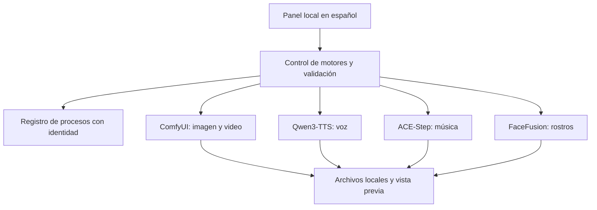

# Arquitectura del estudio



## Procesos y memoria

- El panel escucha en localhost y sirve archivos solamente desde directorios permitidos.
- Cada proceso administrado se identifica mediante PID, instante de creación y ruta del ejecutable. Un PID reutilizado no autoriza detener otro programa.
- La exclusión de motores considera interfaces persistentes y procesos externos registrados. No constituye un bloqueo del sistema operativo para aplicaciones ajenas al estudio.
- Las reservas registradas aparecen en el estado del panel. Los agentes coordinan turnos mediante archivos locales; una intención o un archivo de estado no demuestran que haya un proceso vivo.
- Al observar una tarea larga, se consulta su identificador existente. Un tiempo de observación agotado no justifica volver a enviar el trabajo.

## Organización de ejemplo

```text
workspace/
  apps/
  envs/
  models/
  cache/
  inputs/
  outputs/
  workflows/
  reports/
```

Los entornos, medios y registros de una instalación real no forman parte de esta publicación.

## Controles integrados

- Imagen: descripción, selección entre detalle alto a 1024 píxeles y vista rápida a 512, vista previa y descarga. La creación y entrega del PNG se verificaron mediante la API local; la revisión visual de todos los controles del navegador sigue pendiente.
- Voz: selección de Qwen3-TTS 1.7B o 0.6B y transcripción opcional de la referencia. Una transcripción guardada junto a la muestra se aprovecha automáticamente. Con transcripción se usa el condicionamiento completo; sin ella se conserva la alternativa mediante vector de voz. Se verificó el recorrido de la API del panel al CLI con el modelo 1.7B, transcripción automática de la muestra sintética y descarga del WAV idéntica al archivo local. La revisión visual del navegador se verifica por separado.
- Interfaces completas: inicio, estado y parada de voz y música comparten el registro y el control de motores. Las reservas externas registradas se reflejan en el estado del panel.

- Entrega de medios: bloques de tamaño acotado, HTTP/1.1 y solicitudes de un rango de bytes para reproducción y búsqueda. La galería utiliza miniaturas JPEG cacheadas de 384 × 216; pasaron 24 solicitudes simultáneas en el panel real y se comprobó que los originales permanecen intactos. Los enlaces de descarga conservan el archivo original. La revisión visual de la galería actualizada sigue pendiente y algunos clientes que cierran cada conexión presentan fallos intermitentes al descargar archivos grandes.
