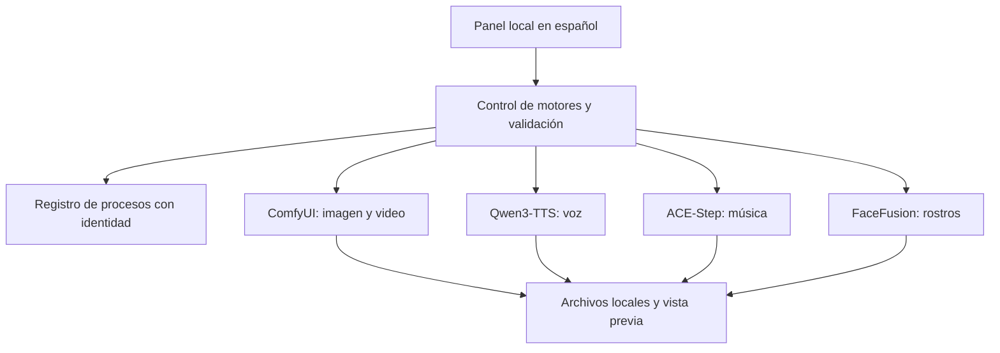

# Arquitectura del estudio



## Procesos y memoria

- El panel escucha en localhost y sirve archivos solamente desde directorios permitidos.
- Cada proceso administrado se identifica mediante PID, instante de creación y ruta del ejecutable. Un PID reutilizado no autoriza detener otro programa.
- La exclusión de motores considera interfaces persistentes y procesos externos registrados. No constituye un bloqueo del sistema operativo para aplicaciones ajenas al estudio.
- Las reservas registradas aparecen en el estado del panel. Los agentes coordinan turnos mediante archivos locales; una intención o un archivo de estado no demuestran que haya un proceso vivo.
- Al observar una tarea larga, se consulta su identificador existente. Un tiempo de observación agotado no justifica volver a enviar el trabajo.

## Organización de ejemplo

```text
workspace/
  apps/
  envs/
  models/
  cache/
  inputs/
  outputs/
  workflows/
  reports/
```

Los entornos, medios y registros de una instalación real no forman parte de esta publicación.
